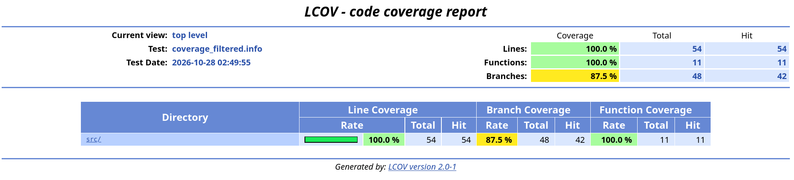
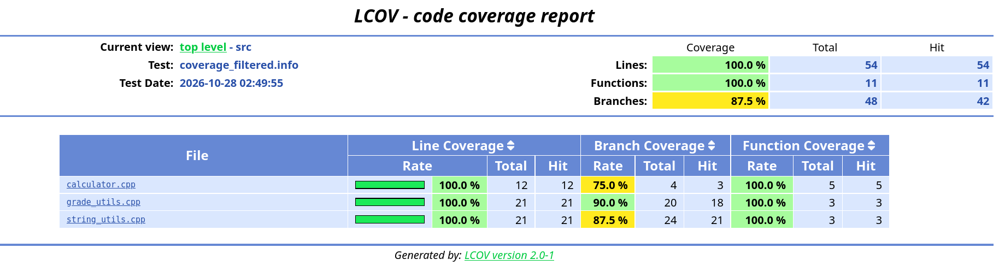

# Parte 5: cobertura de código

## ¿Qué es la cobertura de código?

Es una forma de medir qué partes del código se ejecutaron mientras corrían las pruebas. Se puede ver en:

- **Líneas:** cuántas líneas se ejecutaron por lo menos una vez.
- **Funciones:** cuántas funciones se llamaron por lo menos una vez.
- **Ramas:** en cada decisión (`if`, `&&`, `||`, excepciones), cuántos de los caminos posibles se tomaron.

Sirve para encontrar partes del código que ninguna prueba está tocando.

## Comandos que se usaron

### 1. Compilar con cobertura

Desde `laboratorio-testing`:

```bash
rm -rf build
mkdir build
cd build
cmake -DENABLE_COVERAGE=ON .. > /dev/null
make > /dev/null
./run_tests | tail -n 3
```

```text
[----------] Global test environment tear-down
[==========] 41 tests from 3 test suites ran. (0 ms total)
[  PASSED  ] 41 tests.
```

El `-DENABLE_COVERAGE=ON` activa la opción del `CMakeLists.txt` que compila con `--coverage -O0 -g`. Así, al correr las pruebas se crean unos archivos `.gcda` que guardan cuántas veces se ejecutó cada parte. (El `> /dev/null` solo es para que no se llene la terminal con la salida de `cmake` y `make`; los warnings de CMake siguen saliendo, pero son los mismos de la Parte 2.)

### 2. Primer intento con el comando del enunciado: error `inconsistent`

```bash
lcov --capture --directory . --output-file coverage.info
```

```text
Capturing coverage data from .
geninfo cmd: '/usr/bin/geninfo . --toolname lcov --output-filename coverage.info'
Found gcov version: 14.2.0
Using intermediate gcov format
Recording 'internal' directories:
        /home/yara/Documentos/laboratorio-testing/build
        .
Scanning . for .gcda files ...
Found 8 data files in .
lcov: WARNING: (inconsistent) /usr/include/c++/14/bits/alloc_traits.h:550: unexecuted block on non-branch line with non-zero hit count.  Use "geninfo --rc geninfo_unexecuted_blocks=1 to set count to zero.
        (use "lcov --ignore-errors inconsistent,inconsistent ..." to suppress this warning)
lcov: ERROR: (inconsistent) mismatched end line for _ZN36GradeUtilsTest_CalculateAverage_Test8TestBodyEv at /home/yara/Documentos/laboratorio-testing/tests/test_grade_utils.cpp:5: 5 -> 8 while capturing from ./CMakeFiles/run_tests.dir/tests/test_grade_utils.cpp.gcda
Message summary:
  1 error message:
    inconsistent: 1
  1 warning message:
    inconsistent: 1
```

**¿Por qué pasó?** Debian 13 trae lcov 2, que es mucho más estricto que la versión vieja para la que se escribió el enunciado. Al leer los datos que genera `gcov 14` encontró cosas que no le cuadran: una en un archivo de la librería estándar (`alloc_traits.h`) y otra en el archivo de pruebas, donde la línea final de una prueba de Google Test no coincide con lo que esperaba (pasa porque las macros `TEST` generan código "escondido"). lcov 2 lo toma como un error grave y se detiene sin crear `coverage.info`, así que con este comando no se podía seguir.

**¿Cómo se arregló?** Agregando `--ignore-errors`. Con `inconsistent` puesto dos veces, lcov lo toma como un aviso y sigue. También se agregó `mismatch`, que es otro aviso de lcov 2 que sale con archivos de Google Test cuando se activan las ramas. Además se activó la cobertura de ramas con `--rc branch_coverage=1` y `--branch-coverage`, porque lcov no la muestra si no se le pide.

### 3. Comandos corregidos

```bash
lcov --capture --directory . --output-file coverage.info --rc branch_coverage=1 --ignore-errors inconsistent,inconsistent,mismatch,mismatch
lcov --remove coverage.info '/usr/*' '*/_deps/*' '*/tests/*' --output-file coverage_filtered.info --rc branch_coverage=1 --ignore-errors unused,inconsistent,mismatch
genhtml coverage_filtered.info --output-directory coverage_report --branch-coverage --ignore-errors inconsistent,inconsistent,mismatch
lcov --list coverage_filtered.info --rc branch_coverage=1 --ignore-errors inconsistent,mismatch
firefox "$PWD/coverage_report/index.html" &
```

El `unused` se puso por si algún patrón del `--remove` no encuentra archivos. Y se abrió con `firefox "$PWD/..."` porque así se le da la ruta completa del archivo.

### 4. Lo que salió

Captura de datos:

```text
Found 8 data files in .
Finished processing 8 GCDA files
Finished .info-file creation
Summary coverage rate:
  source files: 79
  lines.......: 32.5% (2110 of 6495 lines)
  functions...: 39.9% (1273 of 3194 functions)
  branches....: 11.0% (946 of 8614 branches)
Message summary:
  101 ignore messages:
    inconsistent: 98
    mismatch: 3
```

Ese 32.5% cuenta también Google Test y las librerías del sistema. Los "101 ignore messages" son los avisos que antes detenían a lcov y que ahora solo se cuentan. Después del filtro (`--remove`) solo quedan los archivos del proyecto:

```text
Removed 76 files
Writing data to coverage_filtered.info
Summary coverage rate:
  source files: 3
  lines.......: 100.0% (54 of 54 lines)
  functions...: 100.0% (11 of 11 functions)
  branches....: 87.5% (42 of 48 branches)
```

Reporte HTML (`genhtml`):

```text
Processing file src/grade_utils.cpp
  lines=21 hit=21 functions=3 hit=3 branches=20 hit=18
Processing file src/calculator.cpp
  lines=12 hit=12 functions=5 hit=5 branches=4 hit=3
Processing file src/string_utils.cpp
  lines=21 hit=21 functions=3 hit=3 branches=24 hit=21
Overall coverage rate:
  source files: 3
  lines.......: 100.0% (54 of 54 lines)
  functions...: 100.0% (11 of 11 functions)
  branches....: 87.5% (42 of 48 branches)
```

Resumen por archivo (`lcov --list`):

```text
                        |Lines       |Functions  |Branches
Filename                |Rate     Num|Rate    Num|Rate     Num
==============================================================
[/home/yara/Documentos/laboratorio-testing/src/]
calculator.cpp          | 100%     12| 100%     5|75.0%      4
grade_utils.cpp         | 100%     21| 100%     3|90.0%     20
string_utils.cpp        | 100%     21| 100%     3|87.5%     24
==============================================================
                  Total:| 100%     54| 100%    11|87.5%     48
```

Página principal del reporte:



Página de la carpeta `src/` con los tres archivos:



## Porcentaje de cobertura

| Archivo | Líneas | Funciones | Ramas |
|---|---|---|---|
| `calculator.cpp` | 100% (12/12) | 100% (5/5) | 75.0% (3/4) |
| `grade_utils.cpp` | 100% (21/21) | 100% (3/3) | 90.0% (18/20) |
| `string_utils.cpp` | 100% (21/21) | 100% (3/3) | 87.5% (21/24) |
| **Total** | **100% (54/54)** | **100% (11/11)** | **87.5% (42/48)** |

(La cobertura se midió con las 41 pruebas que había en ese momento, antes de las partes 9 y 12.)

## Archivos con mayor y menor cobertura

- **En líneas y funciones** los tres archivos tienen 100%, así que están empatados.
- **En ramas** el que tiene más es `grade_utils.cpp` (90%) y el que tiene menos es `calculator.cpp` (75%). Como `calculator.cpp` solo tiene 4 ramas, con que falte una el porcentaje baja bastante.

## Líneas o ramas sin cubrir

**Líneas:** ninguna, todas se ejecutaron.

**Ramas:** quedaron 6 sin tomar. Para saber en qué líneas estaban se revisaron los archivos `.gcov` con `gcov -b`:

| Archivo | Línea | Código |
|---|---|---|
| `calculator.cpp` | 18 | `throw std::invalid_argument("No se puede dividir entre cero");` |
| `grade_utils.cpp` | 6 | `throw std::invalid_argument("La lista de notas no puede estar vacía");` |
| `grade_utils.cpp` | 24 | `throw std::invalid_argument("La nota debe estar entre 0 y 100");` |
| `string_utils.cpp` | 20 | `normalized += ...` |
| `string_utils.cpp` | 24 | `std::string reversed = normalized;` |
| `string_utils.cpp` | 25 | `std::reverse(...)` |

Lo curioso es que **todas** son ramas que gcov marca como `(throw)`. Son caminos que el compilador agrega solo, por si alguna operación interna lanza una excepción; por ejemplo, si se acaba la memoria al crear el texto del error o al copiar un `std::string` (`std::bad_alloc`). No son ramas escritas con un `if` en el código, y en una prueba normal es casi imposible hacer que pasen. Por eso tiene sentido que dé 87.5% aunque las pruebas estén bien hechas.

Todas las ramas "de verdad" (cada `if` cuando es verdadero y cuando es falso) sí se cubrieron, gracias a los casos borde de la Parte 4.

## Pruebas que se podrían agregar

1. **`is_passing` con notas inválidas** (`is_passing(-5)` o `is_passing(150)`): ahorita la función acepta cualquier número. Con esta prueba se vería que falta validar el rango, aunque las líneas ya estén cubiertas.
2. **`count_vowels` con mayúsculas y texto vacío:** `count_vowels("AEIOU") == 5` y `count_vowels("") == 0`, para revisar que el `tolower` sirva y que no pase nada raro con texto vacío.
3. **`is_palindrome` con mayúsculas:** `is_palindrome("Radar")` debería dar `true` gracias al `tolower`.
4. **`average` con una sola nota y con decimales:** `average({70}) == 70.0` y `average({80, 91}) == 85.5`, para ver que no se pierdan los decimales.
5. **Ramas `(throw)`:** solo se podrían cubrir simulando que se acaba la memoria, y eso no vale la pena en un proyecto así.

## Preguntas de reflexión

**1. ¿Qué significa tener 100% de cobertura?**
Que todas las líneas (o funciones, o ramas, según la medida) se ejecutaron por lo menos una vez en las pruebas. Aquí se llegó a 100% en líneas y en funciones.

**2. ¿Tener 100% de cobertura garantiza que el programa no tiene errores?**
No. Solo dice que el código se ejecutó, no que se revisó bien el resultado. Por ejemplo, `is_passing` tiene 100% y aun así acepta una nota de 500 sin decir nada.

**3. ¿Qué diferencia hay entre cobertura de líneas y cobertura de ramas?**
La de líneas solo ve si cada línea se ejecutó. La de ramas ve si se tomó cada camino posible de cada decisión. Una línea como `return grade >= 0 && grade <= 100;` se cubre con una sola prueba, pero tiene varias ramas. En este lab se ve claro: 100% de líneas pero 87.5% de ramas.

**4. ¿Por qué una línea ejecutada no necesariamente significa que fue bien probada?**
Porque se puede ejecutar con un valor que no muestra el error. Por ejemplo, `letter_grade(85)` pasa por la línea `if (grade >= 80)`, pero no detectaría si estuviera escrita como `> 80`; para eso hay que probar justo el 80.

**5. ¿Cómo puede ayudar la cobertura a mejorar las pruebas?**
Muestra en rojo lo que ninguna prueba toca, y así se sabe qué falta probar. Pero hay que usarla como guía y no como meta: lo importante es probar bien, no solo subir el porcentaje.
