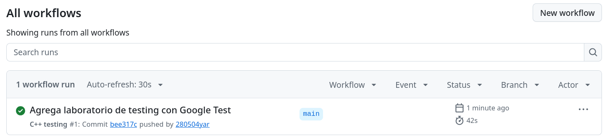
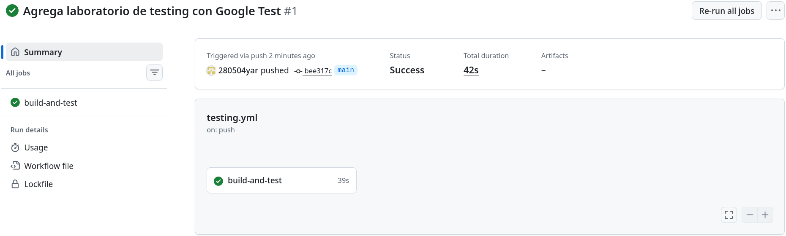
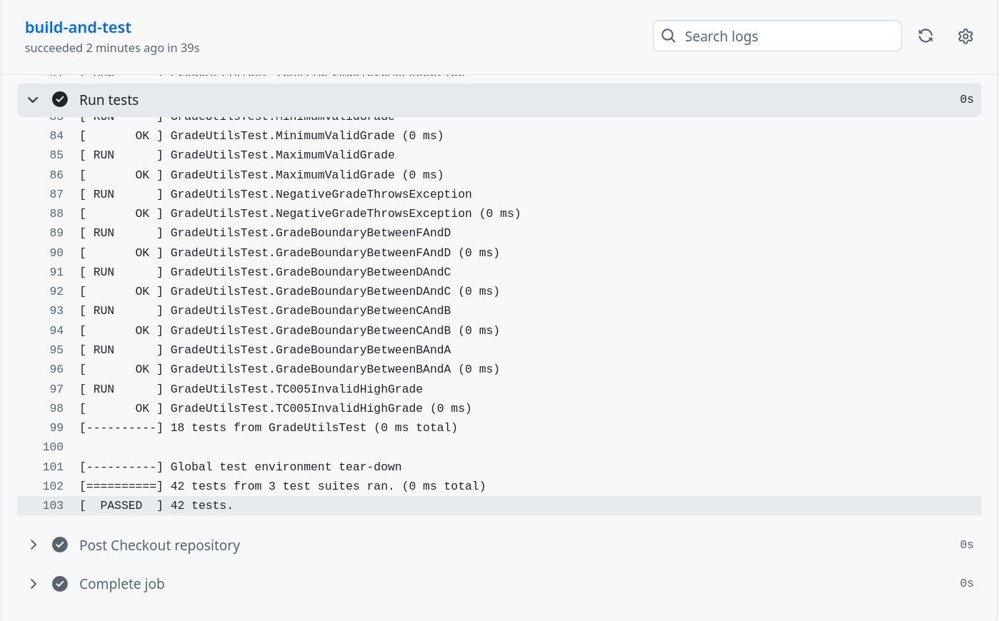
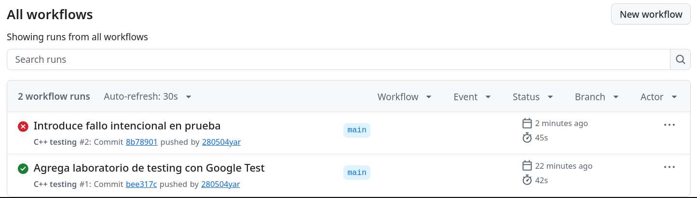
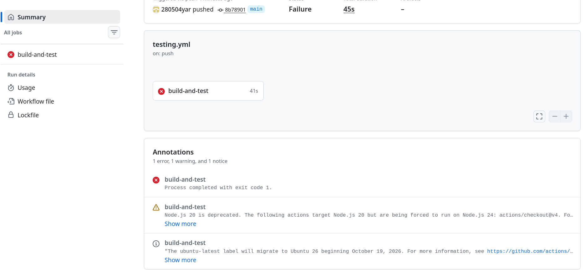
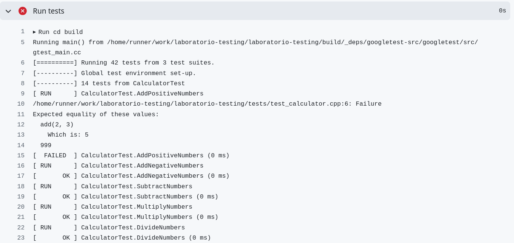
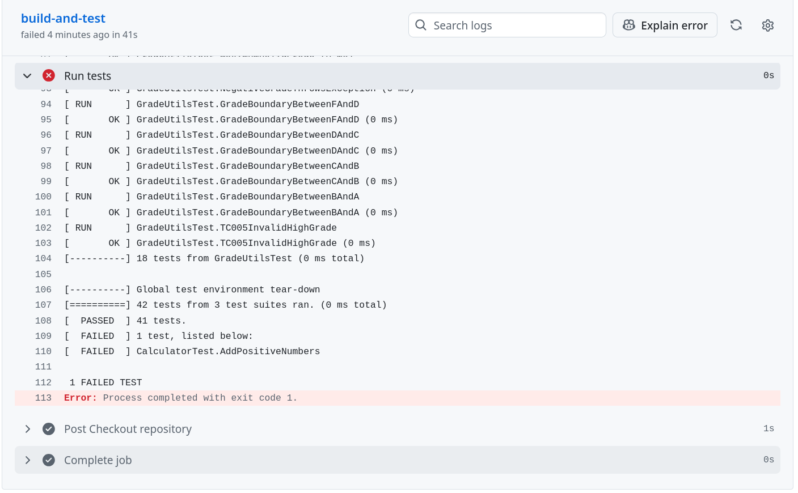
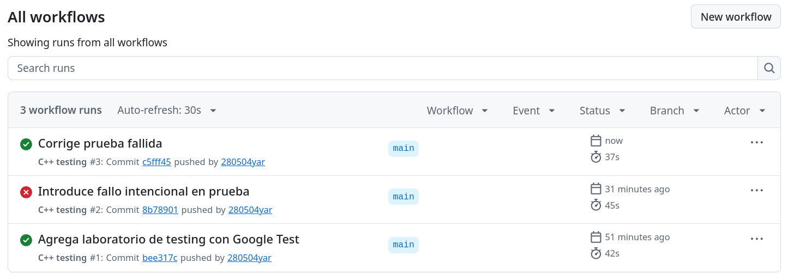
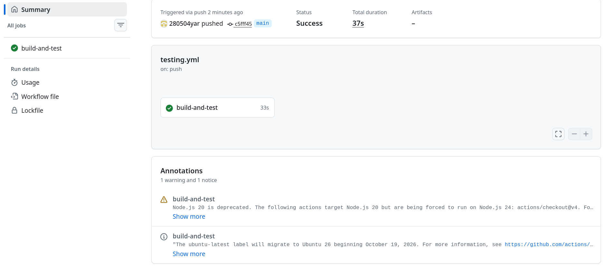
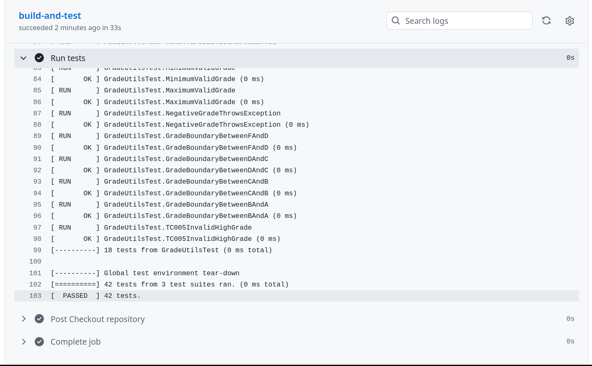

# Parte 6: integración continua con GitHub Actions

## ¿Qué es la integración continua?

La integración continua (CI) es hacer que el código se compile y las pruebas se corran solas cada vez que se sube algo al repositorio. Así, si un cambio daña algo, se sabe en unos minutos y no hasta mucho después. GitHub Actions es la herramienta de GitHub para hacer esto: crea una máquina virtual, baja el código, hace los pasos que se le indican y muestra si todo salió bien (verde) o mal (rojo).

## El archivo `testing.yml`

Está en `.github/workflows/testing.yml`:

```yaml
name: C++ testing

on:
  push:
    branches: [ "main" ]
  pull_request:
    branches: [ "main" ]

jobs:
  build-and-test:
    runs-on: ubuntu-latest

    steps:
      - name: Checkout repository
        uses: actions/checkout@v4

      - name: Install dependencies
        run: |
          sudo apt update
          sudo apt install -y build-essential cmake lcov

      - name: Configure CMake
        run: |
          mkdir -p build
          cd build
          cmake ..

      - name: Build
        run: |
          cd build
          make

      - name: Run tests
        run: |
          cd build
          ./run_tests
```

**Cambio respecto al enunciado:** como este repo es solo del lab, `laboratorio-testing` es la raíz, así que se quitaron los `cd laboratorio-testing`, como dice la nota del enunciado. Si se dejaban, el workflow iba a fallar porque esa carpeta no existe dentro del repo.

## ¿Qué hace el archivo?

Crea un workflow llamado "C++ testing" con un trabajo llamado `build-and-test`, que corre en una máquina con Ubuntu que da GitHub.

## ¿Cuándo se ejecuta?

- **`push` a `main`:** cada vez que se suben cambios a la rama principal.
- **`pull_request` hacia `main`:** cada vez que alguien abre o actualiza un pull request para meter cambios a `main`. Así se revisa antes de aceptarlo.

## ¿Qué pasos hace?

| Paso | Qué hace |
|---|---|
| Checkout repository | Baja el código del repo a la máquina virtual. |
| Install dependencies | Instala `g++` y `make` (`build-essential`), `cmake` y `lcov`. |
| Configure CMake | Crea la carpeta `build` y corre `cmake ..`, que también baja Google Test. |
| Build | Compila con `make`. Si hay un error de compilación, falla aquí. |
| Run tests | Corre `./run_tests`. Si alguna prueba falla, el programa termina con un código distinto de 0 y el workflow queda en rojo. |

## Subida a GitHub

Antes de subir se revisó con `git status` que no apareciera la carpeta `build/`:

```bash
cd ~/Documentos/laboratorio-testing
git status
```

```text
En la rama main
Tu rama está actualizada con 'origin/main'.

Cambios no rastreados para el commit:
        modificados:     README.md

Archivos sin seguimiento:
        .github/
        .gitignore
        CMakeLists.txt
        docs/
        include/
        src/
        tests/
```

`build/` no sale porque está en el `.gitignore`, así que no se suben los ejecutables, ni Google Test, ni los reportes de cobertura. Después se subió todo:

```bash
git add .
git commit -m "Agrega laboratorio de testing con Google Test"
git push
```

```text
[main bee317c] Agrega laboratorio de testing con Google Test
 20 files changed, 451 insertions(+), 1 deletion(-)
 create mode 100644 .github/workflows/testing.yml
 create mode 100644 .gitignore
 create mode 100644 CMakeLists.txt
 ...
 create mode 100644 tests/test_string_utils.cpp
Enumerando objetos: 30, listo.
Contando objetos: 100% (30/30), listo.
Compresión delta usando hasta 8 hilos
Comprimiendo objetos: 100% (18/18), listo.
Escribiendo objetos: 100% (28/28), 4.99 KiB | 300.00 KiB/s, listo.
Total 28 (delta 0), reused 0 (delta 0), pack-reused 0 (from 0)
To https://github.com/280504yar/laboratorio-testing.git
   3523aea..bee317c  main -> main
```

## Evidencia de que el workflow funcionó

En la pestaña **Actions** salió la ejecución "C++ testing #1" del commit `bee317c`. Terminó bien (en verde) y duró 42 s:



Al abrirla, el resumen dice **Success**:



Paso **Run tests** dentro de `build-and-test`:

```text
[ RUN      ] GradeUtilsTest.TC005InvalidHighGrade
[       OK ] GradeUtilsTest.TC005InvalidHighGrade (0 ms)
[----------] 18 tests from GradeUtilsTest (0 ms total)

[----------] Global test environment tear-down
[==========] 42 tests from 3 test suites ran. (0 ms total)
[  PASSED  ] 42 tests.
```



Las mismas 42 pruebas que pasaban en la compu local también pasaron en la máquina de GitHub. Eso demuestra que las pruebas se pueden repetir en otro ambiente.

En el resumen también salen dos avisos amarillos de GitHub ("Node.js 20 is deprecated" y que `ubuntu-latest` va a cambiar a Ubuntu 26). No son errores del proyecto, son avisos de GitHub sobre versiones de sus herramientas, y no afectan el resultado.

## ¿Qué pasaría si una prueba falla en GitHub Actions?

`./run_tests` terminaría con código 1, el paso "Run tests" se pondría en rojo y todo el workflow quedaría como fallido. GitHub pone una X roja al lado del commit, puede mandar un correo avisando y, en un pull request, se ve que las revisiones fallaron antes de hacer el merge. Esto se probó en la siguiente sección.

## Preguntas de reflexión (Parte 10)

**1. ¿Por qué es útil ejecutar pruebas automáticamente en GitHub?**
Porque no depende de que alguien se acuerde de correrlas. Cada push se revisa en una máquina limpia, igual para todos, y queda guardado qué commit pasó y cuál falló.

**2. ¿Qué problema resuelve la integración continua?**
El de que algo funcione en una compu pero no en otra, y el de encontrar errores muy tarde. Con CI se sabe rápido si un cambio rompió algo, cuando todavía es fácil saber qué cambio fue.

**3. ¿Por qué conviene ejecutar pruebas antes de integrar cambios?**
Para no meter errores en `main`, que es la rama que todos usan. Es más fácil rechazar un pull request con pruebas en rojo que arreglar `main` cuando ya otros trabajaron encima.

**4. ¿Qué información da GitHub Actions cuando un workflow falla?**
En qué paso falló, el log completo con la salida de Google Test (archivo, línea, lo esperado y lo que salió), qué commit fue y quién lo subió, cuánto duró y el código de salida (`Process completed with exit code 1`).

**5. ¿Cómo ayuda CI a mejorar la colaboración en equipo?**
Todos ven el mismo resultado (pasó o falló), así que no hay discusiones de en qué compu sí sirve. Se pueden revisar los pull requests con más confianza y nadie daña el trabajo de los demás sin darse cuenta.

---

## Fallo intencional en CI

### Cambio que se hizo para provocar el fallo

En `tests/test_calculator.cpp`, línea 6, se cambió la prueba `AddPositiveNumbers`:

```cpp
EXPECT_EQ(add(2, 3), 5);    // bien
EXPECT_EQ(add(2, 3), 999);  // mal a propósito
```

La función `add` está bien; lo que está mal es la prueba, porque espera un valor que no es.

```bash
sed -i 's/EXPECT_EQ(add(2, 3), 5);/EXPECT_EQ(add(2, 3), 999);/' tests/test_calculator.cpp
grep -n "add(2, 3)" tests/test_calculator.cpp
```

```text
6:    EXPECT_EQ(add(2, 3), 999);
```

### Qué pasó localmente

```bash
cd build && make && ./run_tests --gtest_filter='CalculatorTest.AddPositiveNumbers'; cd ..
```

```text
Note: Google Test filter = CalculatorTest.AddPositiveNumbers
[==========] Running 1 test from 1 test suite.
[----------] Global test environment set-up.
[----------] 1 test from CalculatorTest
[ RUN      ] CalculatorTest.AddPositiveNumbers
/home/yara/Documentos/laboratorio-testing/tests/test_calculator.cpp:6: Failure
Expected equality of these values:
  add(2, 3)
    Which is: 5
  999
[  FAILED  ] CalculatorTest.AddPositiveNumbers (0 ms)
[----------] 1 test from CalculatorTest (0 ms total)

[----------] Global test environment tear-down
[==========] 1 test from 1 test suite ran. (0 ms total)
[  PASSED  ] 0 tests.
[  FAILED  ] 1 test, listed below:
[  FAILED  ] CalculatorTest.AddPositiveNumbers

 1 FAILED TEST
```

Falló: `add(2, 3)` dio 5 y la prueba esperaba 999.

### Subida del error

```bash
git add .
git commit -m "Introduce fallo intencional en prueba"
git push
```

```text
[main 8b78901] Introduce fallo intencional en prueba
 1 file changed, 1 insertion(+), 1 deletion(-)
...
To https://github.com/280504yar/laboratorio-testing.git
   bee317c..8b78901  main -> main
```

### Qué pasó en GitHub Actions

La ejecución "C++ testing #2" (commit `8b78901`) quedó en rojo:



En el resumen sale **Failure** y en las anotaciones aparece el error `Process completed with exit code 1`:



Los pasos "Configure CMake" y "Build" pasaron, porque el código sí compila, pero "Run tests" falló.

### Mensaje que mostró el workflow

Al principio del paso "Run tests":

```text
[ RUN      ] CalculatorTest.AddPositiveNumbers
/home/runner/work/laboratorio-testing/laboratorio-testing/tests/test_calculator.cpp:6: Failure
Expected equality of these values:
  add(2, 3)
    Which is: 5
  999
[  FAILED  ] CalculatorTest.AddPositiveNumbers (0 ms)
```



Y al final del paso:

```text
[==========] 42 tests from 3 test suites ran. (0 ms total)
[  PASSED  ] 41 tests.
[  FAILED  ] 1 test, listed below:
[  FAILED  ] CalculatorTest.AddPositiveNumbers

 1 FAILED TEST
Error: Process completed with exit code 1.
```



Es el mismo mensaje que salió en la compu local. Lo único que cambia es la ruta: `/home/runner/work/...` es la carpeta en la máquina de GitHub. El `exit code 1` es lo que hace que GitHub ponga el paso en rojo.

### Cómo se corrigió

Se volvió a poner el 5 y se subió el cambio:

```bash
sed -i 's/EXPECT_EQ(add(2, 3), 999);/EXPECT_EQ(add(2, 3), 5);/' tests/test_calculator.cpp
grep -n "add(2, 3)" tests/test_calculator.cpp
git add .
git commit -m "Corrige prueba fallida"
git push
```

```text
6:    EXPECT_EQ(add(2, 3), 5);
[main c5fff45] Corrige prueba fallida
 1 file changed, 1 insertion(+), 1 deletion(-)
...
To https://github.com/280504yar/laboratorio-testing.git
   8b78901..c5fff45  main -> main
```

### Evidencia de que funcionó después de corregir

La ejecución "C++ testing #3" (commit `c5fff45`, "Corrige prueba fallida") terminó bien en 37 s. En la lista se ven las tres: la primera bien, la segunda con el fallo y la tercera otra vez bien.





Paso "Run tests" de la corrección:

```text
[----------] Global test environment tear-down
[==========] 42 tests from 3 test suites ran. (0 ms total)
[  PASSED  ] 42 tests.
```



## Preguntas de reflexión (Parte 11)

**1. ¿Por qué es útil ver una prueba fallar al menos una vez?**
Para estar seguros de que la prueba sí sirve y de que CI de verdad avisa cuando algo falla. Una prueba que nunca ha fallado podría estar mal hecha y pasar siempre sin revisar nada.

**2. ¿Qué diferencia hay entre una prueba fallando localmente y una prueba fallando en CI?**
Si falla en la compu local, solo lo ve quien está programando y lo puede arreglar antes de compartirlo. Si falla en CI, queda a la vista de todo el equipo y amarrado a un commit. Además, CI corre en una máquina limpia, así que puede encontrar problemas que en la compu local no salen, como un archivo que se olvidó subir.

**3. ¿Por qué no se debería dejar código con pruebas fallidas en la rama principal?**
Porque `main` tiene que estar siempre funcionando, ya que todos trabajan a partir de ahí. Si ya hay pruebas en rojo, la gente se acostumbra a ignorarlas y un error nuevo pasa desapercibido.

**4. ¿Qué aporta CI a la calidad del software?**
Que cada cambio se revisa siempre igual y de forma automática, sin depender de la memoria de nadie. Los errores se encuentran rápido, quedan registrados y no llegan a los usuarios.
