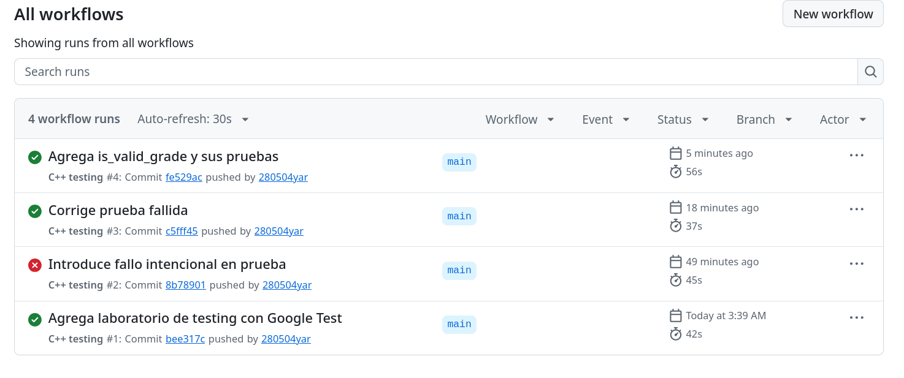
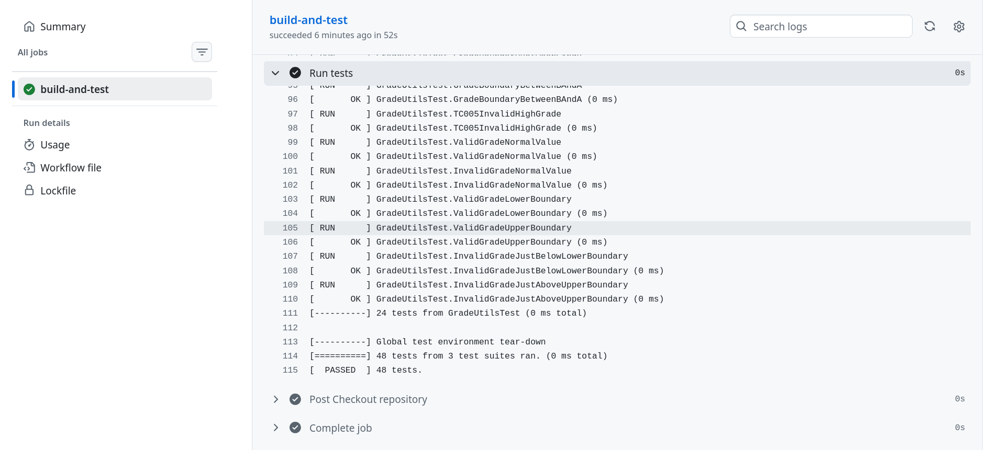

# Mini reto y reflexión final

## Mini reto de testing

### Función implementada

En `include/grade_utils.h`:

```cpp
bool is_valid_grade(int grade);
```

En `src/grade_utils.cpp`:

```cpp
bool is_valid_grade(int grade) {
    return grade >= 0 && grade <= 100;
}
```

La función devuelve `true` si la nota está entre 0 y 100 (incluyendo los dos), y `false` si no.

### Casos de prueba

Se agregaron en `tests/test_grade_utils.cpp`:

```cpp
TEST(GradeUtilsTest, ValidGradeNormalValue) {
    EXPECT_TRUE(is_valid_grade(85));
}

TEST(GradeUtilsTest, InvalidGradeNormalValue) {
    EXPECT_FALSE(is_valid_grade(150));
}

TEST(GradeUtilsTest, ValidGradeLowerBoundary) {
    EXPECT_TRUE(is_valid_grade(0));
}

TEST(GradeUtilsTest, ValidGradeUpperBoundary) {
    EXPECT_TRUE(is_valid_grade(100));
}

TEST(GradeUtilsTest, InvalidGradeJustBelowLowerBoundary) {
    EXPECT_FALSE(is_valid_grade(-1));
}

TEST(GradeUtilsTest, InvalidGradeJustAboveUpperBoundary) {
    EXPECT_FALSE(is_valid_grade(101));
}
```

| Prueba | Entrada | Se espera | Tipo |
|---|---:|---|---|
| `ValidGradeNormalValue` | 85 | `true` | Normal válido |
| `InvalidGradeNormalValue` | 150 | `false` | Normal inválido |
| `ValidGradeLowerBoundary` | 0 | `true` | Borde de abajo, válido |
| `ValidGradeUpperBoundary` | 100 | `true` | Borde de arriba, válido |
| `InvalidGradeJustBelowLowerBoundary` | -1 | `false` | Justo debajo del borde de abajo |
| `InvalidGradeJustAboveUpperBoundary` | 101 | `false` | Justo encima del borde de arriba |

### ¿Por qué se escogieron esos casos?

La función tiene dos límites: 0 y 100. Para cada uno se probó el valor justo adentro (0 y 100) y el valor justo afuera (-1 y 101). Con esos cuatro se detectan los errores más comunes al escribir las comparaciones:

- Si alguien pone `grade > 0`, falla la prueba con 0.
- Si pone `grade < 100`, falla la prueba con 100.
- Si pone `grade >= -1`, falla la prueba con -1.
- Si pone `grade <= 101`, falla la prueba con 101.

El 85 y el 150 son para revisar el comportamiento normal, lejos de los límites. Además, el 150 hace falsa la segunda parte del `&&` y el -1 la primera, así que se prueban las dos partes.

### Resultado de las pruebas

Se compiló y se corrieron las pruebas nuevas con un filtro, y después todas:

```bash
cd build && make && ./run_tests --gtest_filter='*ValidGrade*:-*MinimumValidGrade*:*MaximumValidGrade*' && ./run_tests | tail -n 3; cd ..
```

```text
Note: Google Test filter = *ValidGrade*:-*MinimumValidGrade*:*MaximumValidGrade*
[==========] Running 3 tests from 1 test suite.
[----------] Global test environment set-up.
[----------] 3 tests from GradeUtilsTest
[ RUN      ] GradeUtilsTest.ValidGradeNormalValue
[       OK ] GradeUtilsTest.ValidGradeNormalValue (0 ms)
[ RUN      ] GradeUtilsTest.ValidGradeLowerBoundary
[       OK ] GradeUtilsTest.ValidGradeLowerBoundary (0 ms)
[ RUN      ] GradeUtilsTest.ValidGradeUpperBoundary
[       OK ] GradeUtilsTest.ValidGradeUpperBoundary (0 ms)
[----------] 3 tests from GradeUtilsTest (0 ms total)

[----------] Global test environment tear-down
[==========] 3 tests from 1 test suite ran. (0 ms total)
[  PASSED  ] 3 tests.
[----------] Global test environment tear-down
[==========] 48 tests from 3 test suites ran. (0 ms total)
[  PASSED  ] 48 tests.
```

El filtro solo mostró 3 de las 6 pruebas nuevas porque los filtros de Google Test distinguen mayúsculas: `*ValidGrade*` no encuentra los nombres que dicen `InvalidGrade...` (con `v` minúscula). Pero el total subió de 42 a **48**, así que las 6 pruebas corrieron y pasaron. En GitHub Actions se ven las 6 una por una (más abajo).

Al compilar salió otra vez el aviso `libgcov profiling error: ... overwriting an existing profile data with a different checksum`. No es un error de las pruebas: sale porque la carpeta `build` todavía tenía la cobertura activada (Parte 5) y, al recompilar, se reemplazaron los datos de cobertura viejos.

### ¿Se subieron los cambios a GitHub?

Sí:

```bash
git add .
git commit -m "Agrega is_valid_grade y sus pruebas"
git push
```

```text
[main fe529ac] Agrega is_valid_grade y sus pruebas
 3 files changed, 29 insertions(+)
...
To https://github.com/280504yar/laboratorio-testing.git
   c5fff45..fe529ac  main -> main
```

### ¿GitHub Actions corrió bien?

Sí. La ejecución "C++ testing #4" (commit `fe529ac`) terminó bien en 56 s:



En el paso "Run tests" se ven las 6 pruebas nuevas en `OK` y el total de 48:

```text
[ RUN      ] GradeUtilsTest.ValidGradeNormalValue
[       OK ] GradeUtilsTest.ValidGradeNormalValue (0 ms)
[ RUN      ] GradeUtilsTest.InvalidGradeNormalValue
[       OK ] GradeUtilsTest.InvalidGradeNormalValue (0 ms)
[ RUN      ] GradeUtilsTest.ValidGradeLowerBoundary
[       OK ] GradeUtilsTest.ValidGradeLowerBoundary (0 ms)
[ RUN      ] GradeUtilsTest.ValidGradeUpperBoundary
[       OK ] GradeUtilsTest.ValidGradeUpperBoundary (0 ms)
[ RUN      ] GradeUtilsTest.InvalidGradeJustBelowLowerBoundary
[       OK ] GradeUtilsTest.InvalidGradeJustBelowLowerBoundary (0 ms)
[ RUN      ] GradeUtilsTest.InvalidGradeJustAboveUpperBoundary
[       OK ] GradeUtilsTest.InvalidGradeJustAboveUpperBoundary (0 ms)
[----------] 24 tests from GradeUtilsTest (0 ms total)

[----------] Global test environment tear-down
[==========] 48 tests from 3 test suites ran. (0 ms total)
[  PASSED  ] 48 tests.
```



### Preguntas de reflexión (mini reto)

**1. ¿Cuál fue el caso más obvio de probar?**
El de una nota normal válida, `is_valid_grade(85)`, porque es lo primero que se le ocurre a cualquiera: una nota común que tiene que ser aceptada.

**2. ¿Cuál fue el caso borde más importante?**
Los dos extremos válidos, 0 y 100, junto con -1 y 101. Si hubiera que escoger solo uno, sería el 100, porque es una nota real (la máxima) y si alguien pone `< 100` en vez de `<= 100`, se rechazaría la nota perfecta de un estudiante.

**3. ¿Qué error podría aparecer si no se prueban los valores `0` y `100`?**
Un error de "uno de más o uno de menos": poner `>` en vez de `>=` o `<` en vez de `<=`. El código parecería funcionar con 50 u 85, pero rechazaría las notas de 0 o 100, que sí son válidas.

**4. ¿Qué diferencia hay entre probar un valor como `50` y probar valores como `-1`, `0`, `100` y `101`?**
El 50 está lejos de los límites, así que casi cualquier versión de la función, aunque esté mal, va a dar `true`. En cambio -1, 0, 100 y 101 están justo en la frontera entre válido e inválido, que es donde se nota si las comparaciones están bien escritas.

**5. ¿Qué se aprendió sobre diseñar pruebas?**
Que no se trata de hacer muchas pruebas, sino de escoger bien los casos: uno normal, los límites y los inválidos. Primero hay que entender qué tiene que hacer la función y dónde están sus límites, y después buscar los valores donde podría fallar.

---

## Reflexión final

**1. ¿Qué es software testing?**
Es revisar que un programa haga lo que tiene que hacer, corriéndolo con casos preparados y comparando lo que da con lo que debería dar, para encontrar errores antes de que lleguen a los usuarios.

**2. ¿Por qué el testing mejora la calidad del software?**
Porque los errores se encuentran temprano, cuando es más fácil arreglarlos. Además, si un cambio daña algo (como pasó con `is_even` en la Parte 3), las pruebas avisan de una vez. También sirven para dejar claro cómo debe funcionar el código.

**3. ¿Cuál es la diferencia entre verificación y validación?**
- **Verificación:** revisar que el producto se hizo bien, o sea, que el código cumple con lo que dice la especificación. Por ejemplo, que `letter_grade(80)` dé `'B'`.
- **Validación:** revisar que se hizo el producto correcto, o sea, que de verdad sirve para lo que necesita el usuario. Por ejemplo, que la escala de A a F sea la que usa la universidad.

Las pruebas unitarias de este lab son más que todo de verificación.

**4. ¿Qué es una prueba unitaria?**
Una prueba pequeña, rápida y automática que revisa una sola parte del código, como una función, por aparte. Por ejemplo, `EXPECT_EQ(add(2, 3), 5)`.

**5. ¿Qué es una prueba funcional?**
Una prueba que sale de un requisito y piensa en lo que espera el usuario. Revisa qué tiene que hacer el sistema, no cómo está programado. Por ejemplo, la tabla de TC-001 a TC-005 de la Parte 9.

**6. ¿Qué diferencia hay entre `EXPECT_` y `ASSERT_`?**
Si falla, `EXPECT_` marca el error y la prueba sigue; `ASSERT_` marca el error y la prueba se detiene ahí. `ASSERT_` se usa cuando no tiene sentido seguir, como cuando el divisor es 0 y no se debe dividir.

**7. ¿Por qué las pruebas deben ser deterministas?**
Porque con el mismo código tienen que dar siempre el mismo resultado. Si una prueba a veces pasa y a veces no, no se puede confiar en ella.

**8. ¿Por qué puede ser útil una semilla en pruebas con valores aleatorios?**
Porque se puede probar con números variados, pero siempre los mismos. Con la semilla 12345 salen siempre los mismos números, así que si algo falla se puede repetir y revisar.

**9. ¿Qué es cobertura de código?**
Es el porcentaje del código (líneas, funciones o ramas) que se ejecutó durante las pruebas. En este lab dio 100% de líneas, 100% de funciones y 87.5% de ramas.

**10. ¿Por qué una cobertura alta no garantiza ausencia de errores?**
Porque que una línea se ejecute no quiere decir que su resultado se haya revisado bien. Por ejemplo, `is_passing` tiene 100% de cobertura y aun así acepta una nota de 500. La cobertura dice qué se ejecutó, no si funciona bien.

**11. ¿Qué ventaja tiene ejecutar pruebas en GitHub Actions?**
Que cada push se prueba solo, en una máquina limpia, sin depender de que alguien se acuerde. Se vio en la Parte 11: se subió un error a propósito y en un minuto GitHub lo marcó como fallido, con el mismo mensaje que salía en la compu local.

**12. ¿Qué parte del laboratorio le pareció más útil?**
Los casos borde y el fallo a propósito en CI. Los casos borde enseñan a escoger los valores pensando bien (59/60, 0/100, -1/101) en vez de poner números al azar. Y ver el fallo en rojo en GitHub ayuda a entender para qué sirve todo esto en un proyecto real.

**13. ¿Qué parte le pareció más difícil?**
La cobertura con lcov. Debian 13 trae lcov 2, que es más estricto que el del enunciado, y el comando tal como venía se detuvo con el error `inconsistent`, que no venía del código del proyecto sino de la librería estándar y de cómo Google Test arma las pruebas. Hubo que leer bien el mensaje y agregar `--ignore-errors` (para `inconsistent` y `mismatch`). También costó entender por qué las ramas daban 87.5% si las líneas daban 100% (por las ramas `throw` que agrega el compilador).

**14. ¿Cómo aplicaría pruebas automatizadas en un proyecto futuro?**
- Separar desde el inicio `src/`, `include/` y `tests/`, y usar CMake con Google Test.
- Para cada función, hacer pruebas con un caso normal, los límites y los inválidos.
- Cuando aparezca un error, primero hacer una prueba que lo muestre y después arreglarlo.
- Poner GitHub Actions desde el primer día y no meter nada a `main` si las pruebas están en rojo.
- Revisar la cobertura de vez en cuando para ver qué falta probar, pero sin obsesionarse con llegar al 100%.
- Si se usan números aleatorios, siempre con una semilla fija y anotada.
